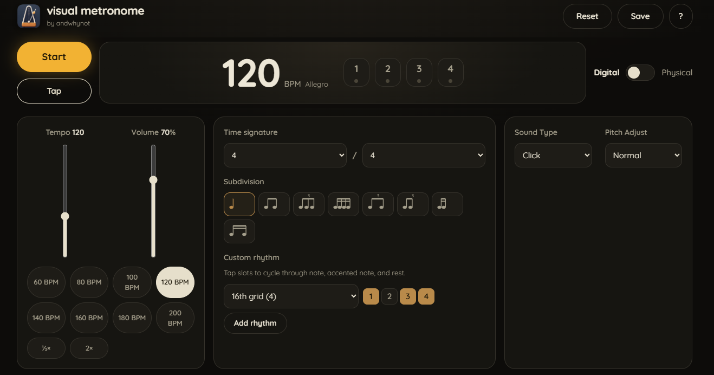
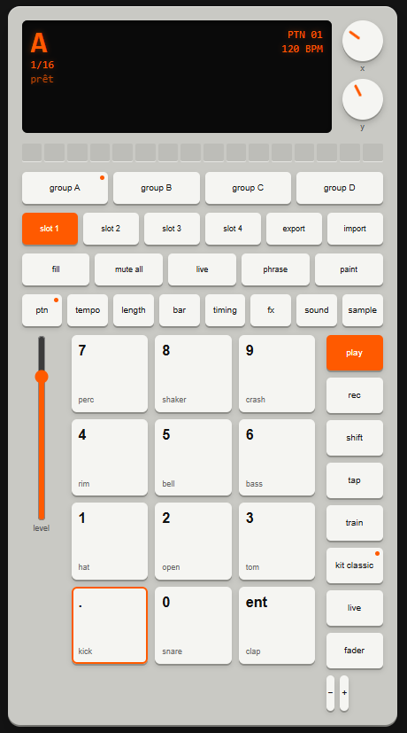

# catalogue

Ce dépôt sert de page centrale pour présenter deux outils web   :

- **Metronome** — métronome visuel (PWA) : tempo, rythmes, accents, préréglages et outils d'entraînement.
  - Dépôt : https://github.com/thibautpe/metronome
  - Démonstration : disponible via GitHub Pages si le site est publié depuis le dossier `docs/`.

- **Boîte à rythmes** —  Sequencer léger (PWA) pour créer des patterns et jouer des grooves.
  - Dépôt : https://github.com/thibautpe/boite-a-rythmes
  - Démonstration en ligne : https://thibautpe.github.io/boite-a-rythmes/
  - Documentation et ressources : `Home.md`

## Capture d'écran

## Ressources du dépôt

- `Home.md` — présentation détaillée et liens vers les démonstrations.
- `docs/` — pages statiques utilisables pour GitHub Pages (par exemple `/docs/index.html`).
- `manifest.webmanifest` et `sw.js` — manifest et service worker pour la PWA.

## Déploiement GitHub Pages

Un workflow GitHub Actions (fichier `.github/workflows/deploy-docs.yml`) publie automatiquement le contenu du dossier `docs/` sur la branche `gh-pages` quand tu pousses sur `main`. Cela crée un site GitHub Pages pour le dépôt. Si tu préfères publier directement depuis `docs/` sur la branche `main`, tu peux activer cette option dans les paramètres du dépôt (Settings → Pages).
 
